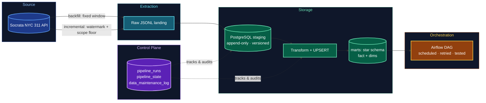

# NYC 311 Incremental Pipeline


A production-style incremental ELT pipeline for NYC's 311 Service Request data — built to load only new or changed records, stay correct under retries and partial failures, and leave an auditable trail of exactly what happened and when.

## The problem

NYC's 311 system logs thousands of new service requests a day, and existing ones get updated repeatedly as they move through the system (status changes, agency reassignment, closure). A naive full-refresh load doesn't scale past a few million rows and can't distinguish a brand-new complaint from an update to an old one. This project builds a pipeline that:

- loads only what's new or changed, using a watermark on the source's own revision timestamp
- stays correct if a run fails partway through or is re-run on top of itself (idempotent by design, not by luck)
- keeps a full, append-only history of every version of every record, separate from the audit log of pipeline runs
- never silently loses a correction — every manual fix is logged and reconciled against the row count, not just assumed correct

## Architecture



**Flow:** Socrata SoQL API → raw JSONL landing → PostgreSQL `staging` (append-only) → transform/UPSERT → `marts` star schema → Airflow orchestration. A `control` schema runs alongside every stage, tracking watermarks, logging every run, and recording every manual correction.

**Legend:** blue = extraction &middot; teal = raw landing &middot; green = storage (staging + marts) &middot; amber = orchestration &middot; purple = control plane (audit, watermark, correction log) — wired to every storage stage it governs.

## Project at a glance

| Metric | Value |
|---|---|
| Source dataset size | ~22.5M rows ([NYC Open Data](https://data.cityofnewyork.us/Social-Services/311-Service-Requests-from-2020-to-Present/erm2-nwe9)) |
| Project scope | Complaints created on/after 2025-10-01, extended forward incrementally |
| Historical backfill | 3,963,897 rows, one fixed-window extraction |
| Incremental runs completed | 2, both `SUCCESS`, watermark-driven |
| Rows currently in staging | 5,123,301 (reconciled: inserted − corrected = actual, difference = 0) |
| Out-of-scope rows caught and corrected | 77,794, via an audited, logged deletion |

## Engineering highlights

A few real design problems found and fixed during development — the kind of thing that matters more than the happy path:

- **A missing watermark field, caught before it could cause silent data loss.** The first backfill extraction used Socrata's default field selection, which quietly excludes `:updated_at` — a system field, not a regular column. That meant the field this entire incremental design depends on was never captured, not even in the raw JSON payload. Rather than patch around it, the ~3.96M-row backfill was re-extracted with the corrected field selection.
- **A primary key that looked right but wasn't.** The staging table's load timestamp (`_loaded_at`) is pinned once per transaction, not per row — so two genuinely different revisions of the same complaint loaded in the same batch could collide on a primary key built from it. Corrected the key to `(unique_key, updated_at)`, the field that actually identifies a distinct version of a record.
- **Watermark vs. scope are two different filters, and conflating them is a real bug.** The incremental loader filtered only on *when* something changed (`updated_at`), with no floor on *which population* is in scope at all (`created_date`). That let a complaint from 2020 — and ~379,000 others outside the project's intended window — leak into a pipeline scoped to the last 12 months. Fixed by adding an explicit, open-ended scope floor (deliberately no ceiling, since the incremental pipeline's whole job is to keep extending forward).
- **Corrections are logged, not retro-edited.** Rather than editing the run-history table after the fact to "fix" the numbers, manual corrections (like removing the out-of-scope rows above) are written to a separate, append-only `data_maintenance_log`, then verified with a reconciliation query that proves `total inserted − total corrected = actual row count` exactly.

## Data model

**Staging layer** — `staging.staging_311_requests`
Append-only landing table: 48 source fields + `raw_payload JSONB` (full original record) + `_loaded_at` / `_source_file` (pipeline-owned metadata). Primary key `(unique_key, updated_at)` — every distinct version of every complaint is kept, nothing is overwritten.

**Control layer** — `control` schema
- `pipeline_runs` — append-only audit log, one row per run attempt, with CHECK constraints enforcing a valid lifecycle (every completed run has a finish time; row counts are internally consistent; the watermark window is well-formed).
- `pipeline_state` — single current watermark pointer per pipeline; the loader's "where did we leave off."
- `data_maintenance_log` — append-only log of manual corrections, independently reconciled against `pipeline_runs` and the live row count.

**Marts layer** (in progress) — `marts` schema, star schema: `fact_service_requests` at one row per `unique_key`, with `dim_agency`, `dim_complaint_type`, `dim_location`, and a role-playing `dim_date`. Design decisions for each are recorded as ADRs below.

## Tech stack

| Layer | Tools |
|---|---|
| Extraction | Python, `requests`, Socrata SoQL API |
| Transformation | `pandas` |
| Loading | `psycopg2` (bulk `COPY`), `SQLAlchemy` |
| Database | PostgreSQL (local), DBeaver as GUI client |
| Orchestration (planned) | Apache Airflow (Docker) |
| Testing (planned) | `pytest` + SQL-based data quality checks |
| Version control | Git / GitHub, feature-branch + PR workflow |

## Design decisions (ADRs)

| ADR | Decision |
|---|---|
| [0001](notes/decisions/0001-fact-table-grain.md) | Fact table grain — one row per `unique_key` |
| [0002](notes/decisions/0002-watermark-strategy.md) | Watermark strategy — use `:updated_at` for incremental loads |
| [0003](notes/decisions/0003-dim-agency-canonical-label.md) | `dim_agency` canonical label — majority-vote per agency code |
| [0004](notes/decisions/0004-dim-complaint-type-normalization.md) | `dim_complaint_type` — normalize casing/whitespace to one canonical label |
| [0005](notes/decisions/0005-dim-location-borough-placeholders.md) | `dim_location` — explicit placeholder rows for missing/unspecified borough |
| [0006](notes/decisions/0006-dim-date-role-playing.md) | `dim_date` — single role-playing dimension, bounded range with an invalid-date placeholder |
| [0007](notes/decisions/0007-staging-append-only-history.md) | Append-only staging to preserve history under an UPSERT fact table |

## Repository structure

```
project3_NYC311/
├── notes/
│   ├── decisions/                       # ADRs (7, all accepted)
│   ├── data_exploration.md
│   ├── extraction_approach.md
│   └── nyc311_dataset_schema_reference.md
├── scripts/
│   ├── backfill_extract.py              # one-time historical extraction (fixed window)
│   ├── incremental_extract_load.py      # watermark-driven, idempotent incremental load
│   ├── load_staging.py                  # bulk COPY loader into Postgres staging
│   └── check_last_line.py               # resume-safety check for long-running extractions
├── sql/
│   ├── 001_create_staging_table.sql
│   └── 002_add_watermark_column.sql
├── requirements.txt
└── README.md
```

*Note: the `control` schema (`pipeline_runs`, `pipeline_state`, `data_maintenance_log`) currently exists in the live database; the matching version-controlled migration files are the next commit.*

## Getting started

```bash
# 1. Clone and set up the environment
git clone https://github.com/Hanyyoussef4/nyc-311-incremental-pipeline.git
cd nyc-311-incremental-pipeline
python3 -m venv venv && source venv/bin/activate
pip install -r requirements.txt

# 2. Configure the database connection
# create a .env file with: DB_HOST, DB_PORT, DB_NAME, DB_USER, DB_PASSWORD

# 3. Create the schema (staging layer; control-schema migration files are in progress — see note above)
psql -d nyc311 -f sql/001_create_staging_table.sql
psql -d nyc311 -f sql/002_add_watermark_column.sql

# 4. Run the one-time historical backfill
python scripts/backfill_extract.py
python scripts/load_staging.py

# 5. Run incremental loads going forward (designed to be safely re-run or scheduled)
python scripts/incremental_extract_load.py
```

## Status

- [x] Repo scaffolding (venv, `.gitignore`, `requirements.txt`)
- [x] Data exploration
- [x] Schema design + ADRs
- [x] Initial backfill (watermark gap found and corrected)
- [x] Postgres staging (primary key corrected to the true version key)
- [x] Incremental load logic — watermark-bound, scope-bound, idempotent, fully audited
- [ ] Transform + UPSERT into star schema (`marts`)
- [ ] Data quality checks
- [ ] Airflow DAG
- [ ] Failure testing (kill mid-run, re-run on top of a failure)
- [ ] Architecture diagram (static), final write-up

## What this project demonstrates

Incremental/CDC-style extraction with a correctly-chosen watermark field; idempotent, retry-safe loading; append-only history under an eventually-UPSERT fact table; schema design backed by written ADRs; an auditable control layer that never needs retroactive edits; and a data-correction workflow that's verified by reconciliation, not assumption.

